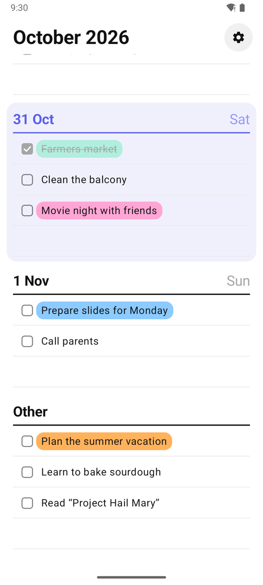
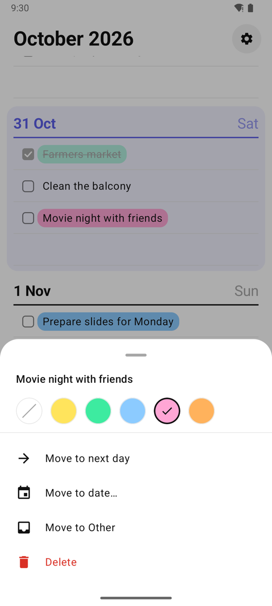
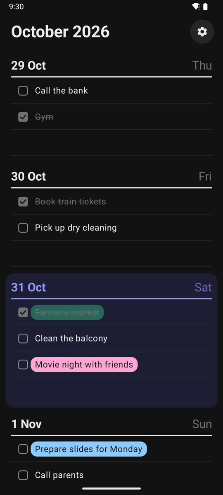
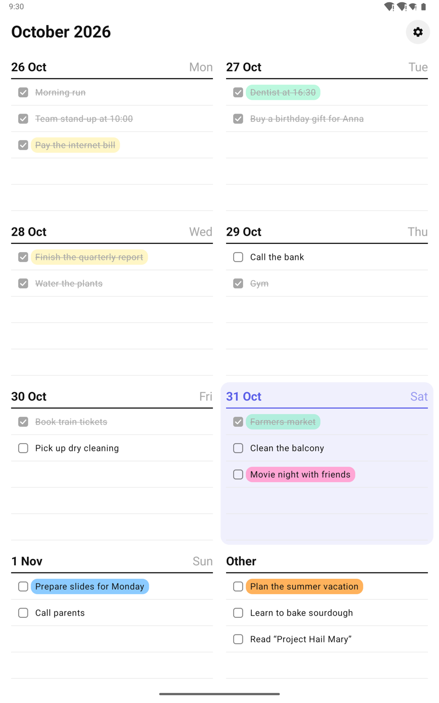

# Planner

**English** · [Русский](README.ru.md)

A paper-style weekly planner for Android. One screen is one week: swipe left or right to move between weeks, tap a line to write a task, tick it off when it is done. It works fully offline and can optionally sync through a file on your Dropbox or Yandex Disk.

<p>
  
  
  
</p>
<p>
  
</p>

## Download

**[⬇ Download planner.apk](https://github.com/Ivanopulo124/mobile_notebook/raw/main/dist/planner.apk)** · version 0.2.0 · 2.4 MB · Android 8.0 or newer

1. Open the link on your phone and download the file.
2. Open the downloaded `planner.apk`. If Android asks, allow your browser or file manager to install unknown apps.
3. If Google Play Protect warns about an unknown app, choose **Install anyway**. The app is not on Google Play, so Play Protect does not know it yet.

New versions install over the old one and keep your tasks. Sync with Dropbox or Yandex Disk is optional; everything works without it.

<details>
<summary>Verify the download</summary>

SHA-256 of `planner.apk` 0.2.0:

```
bcb3fad5c4366faba9ea7fd6ed24fa3b22a0f0771888bee7b0b89bfefcde991c
```

</details>

## Features

- **One week per screen.** Swipe to change weeks; the round calendar button jumps back to the current week. Today's day is highlighted, and the current week scrolls to it when the app opens.
- **Write on the lines.** Tap an empty line to add a task and press Enter to keep adding. Tap a task to edit it; clear its text to delete it.
- **Tick tasks off.** Done tasks are greyed out and struck through. The sweep icon in a day's header deletes its done tasks at once, with undo.
- **Other.** A list for tasks without a date, shown after Sunday.
- **Long-press menu.** Color highlight (five colors), move to the next day, move to any date, move to Other, delete with undo.
- **Phones and tablets.** Portrait layout with one column on phones and two on tablets.
- **Light and dark themes.** Follows the system or can be forced in Settings.
- **Optional Dropbox or Yandex Disk sync.** Tasks are kept in the app's own folder in your cloud storage; the app cannot see your other files.
- **English and Russian**, picked from the system language.

## Building

Requirements: Android SDK with platform 37 (Android Gradle Plugin downloads it automatically when the SDK licenses are accepted) and JDK 17 or newer to run Gradle.

```bash
./gradlew :app:installDebug
```

The app targets Android 16 (API 36) and runs on Android 8.0 (API 26) and newer.

`./gradlew :app:assembleRelease` builds a shrunk release APK. It is signed when these properties are set, for example in `~/.gradle/gradle.properties` (never in the repository); without them the release APK is built unsigned:

```properties
PLANNER_RELEASE_STORE_FILE=/path/to/release.jks
PLANNER_RELEASE_STORE_PASSWORD=...
PLANNER_RELEASE_KEY_ALIAS=...
PLANNER_RELEASE_KEY_PASSWORD=...
```

To publish a new version, raise `versionCode` and `versionName` in `app/build.gradle.kts`, build the release, copy it to `dist/planner.apk` and update the version and checksum in both READMEs.

## Sync setup

Sync is optional; without it the app works entirely offline. Each provider needs a registered app whose public ID goes into the build through Gradle properties, for example in `~/.gradle/gradle.properties`. A build without an ID simply hides that provider.

```properties
PLANNER_DROPBOX_APP_KEY=...
PLANNER_YANDEX_CLIENT_ID=...
```

### Dropbox

1. In the [Dropbox App Console](https://www.dropbox.com/developers/apps) create an app with **Scoped access** and **App folder** access.
2. On the **Permissions** tab enable `files.content.read`, `files.content.write` and `account_info.read`.
3. On the **Settings** tab add the redirect URI `db-<app key>://oauth` and copy the **App key** into `PLANNER_DROPBOX_APP_KEY`. The app secret is not used.
4. A new Dropbox app is in development status and works right away. Once it has 50 linked users, Dropbox gives two weeks to apply for production status (free) before new users are blocked.

### Yandex Disk

1. On [oauth.yandex.ru](https://oauth.yandex.ru/) create an app. Platform: **Android app**, package name `com.ivanopulo.planner` and the SHA-256 fingerprint of each signing key. For the debug key:
   ```bash
   keytool -list -v -keystore ~/.android/debug.keystore -alias androiddebugkey -storepass android | grep SHA256
   ```
2. Data access: **Yandex Disk** → *Access to the app folder on Yandex Disk* (`cloud_api:disk.app_folder`), and **Yandex ID** → *Access to email address* (`login:email`).
3. Copy the **ClientID** into `PLANNER_YANDEX_CLIENT_ID`.

Then open **Settings → Sync** in the app and sign in with either service.

### How sync works

- All tasks, including deletion markers, are stored in one `planner.json` in the app folder: `Apps/<app name>` on Dropbox, `Applications/<app name>` on Yandex Disk.
- Each task carries a last-changed timestamp; when devices disagree the newer version wins, and a sync never overwrites a task that was edited locally while the sync was running.
- Sync runs when the app comes to the foreground, five seconds after the last edit, every 12 hours in the background and on demand, and only with a network connection.
- Tokens are kept in a separate file that is left out of Android backups, so a restored app asks to sign in again.
- Signing out keeps all tasks on the device and forgets the token; for Dropbox it is also revoked.

## Architecture

Single-activity Kotlin app with Jetpack Compose and Material 3, no DI framework.

| Layer | Contents |
| --- | --- |
| `domain` | `Task`, `TaskColor`, week arithmetic (`Weeks`) |
| `data` | Room database (`TaskEntity`, `TaskDao`), `TaskRepository`, DataStore settings |
| `sync` | `SyncEngine` and `TaskMerge` (pure logic), `DropboxAuth` (OAuth with PKCE) and `DropboxRemoteStore`, `YandexAuth` (Yandex ID SDK) and `YandexRemoteStore`, `SyncManager` and `SyncWorker` (WorkManager) |
| `ui` | Week pager, day blocks and inline editing, task menu, settings |

Weeks are pages of a `HorizontalPager` counted from the week the app was started in. Deleted tasks are soft-deleted so the deletion can reach other devices through sync.

```
app/src/main/java/com/ivanopulo/planner/
├── domain/
├── data/
├── sync/
└── ui/
    ├── components/
    ├── settings/
    ├── theme/
    └── week/
```

## Tests

```bash
./gradlew :app:testDebugUnitTest
```

Unit tests cover week arithmetic, the task repository (against an in-memory DAO), the merge rules, the sync file format, full sync cycles against a fake remote, PKCE, and the Dropbox and Yandex Disk stores against a fake HTTP client.
