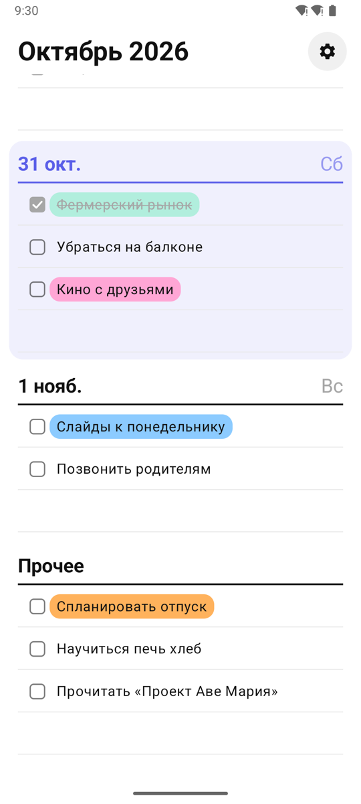
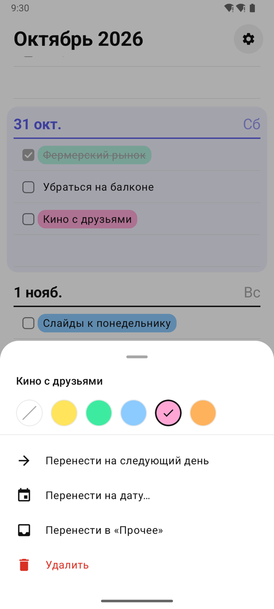
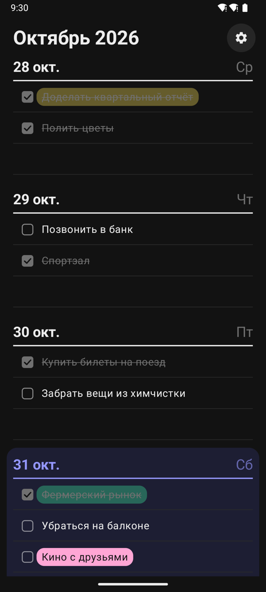
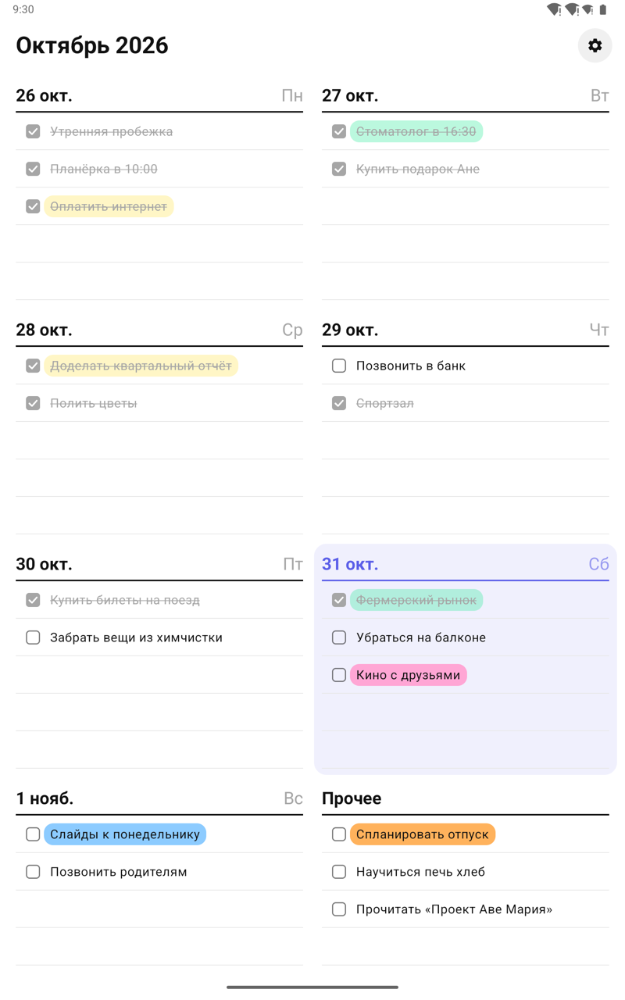

# Ежедневник

[English](README.md) · **Русский**

Еженедельник для Android в духе бумажного планера. Один экран — одна неделя: свайпом влево и вправо листаются недели, нажатие на строку — новая задача, галочка — задача выполнена. Работает полностью офлайн и по желанию синхронизируется через файл на Google Drive.

<p>
  
  
  
</p>
<p>
  
</p>

## Возможности

- **Неделя на экране.** Недели листаются свайпом, круглая кнопка с календарём возвращает к текущей неделе. Сегодняшний день выделен.
- **Пишите на строчках.** Нажмите на пустую строку, чтобы добавить задачу, и Enter, чтобы сразу добавить следующую. Нажатие на задачу — редактирование, стёртый текст — удаление.
- **Отмечайте выполненное.** Выполненные задачи становятся серыми и зачёркнутыми.
- **Прочее.** Список задач без даты после воскресенья.
- **Меню по долгому нажатию.** Цветное выделение (пять цветов), перенос на следующий день, на любую дату или в «Прочее», удаление с возможностью отмены.
- **Телефоны и планшеты.** Портретная ориентация: одна колонка на телефоне, две на планшете.
- **Светлая и тёмная темы.** Как в системе или выбранная в настройках.
- **Синхронизация через Google Drive по желанию.** Задачи лежат в скрытой папке приложения на вашем Drive, к остальным файлам у приложения нет доступа.
- **Русский и английский** языки — по языку системы.

## Сборка

Нужны Android SDK с платформой 37 (Android Gradle Plugin скачает её сам, если лицензии SDK приняты) и JDK 17 или новее для запуска Gradle.

```bash
./gradlew :app:installDebug
```

Приложение нацелено на Android 16 (API 36) и работает на Android 8.0 (API 26) и новее.

## Настройка синхронизации с Google Drive

Синхронизация необязательна: без неё приложение полностью работает офлайн. Google узнаёт Android-приложения по имени пакета и отпечатку ключа подписи, поэтому client ID в коде нет, но для каждой подписи сборки нужен свой OAuth-клиент:

1. В [Google Cloud Console](https://console.cloud.google.com/) создайте проект и включите **Google Drive API**.
2. В **Google Auth Platform** настройте экран согласия: аудитория *External*, режим *Testing*, добавьте свой аккаунт в тестовые пользователи и добавьте scope `https://www.googleapis.com/auth/drive.appdata`.
3. Создайте OAuth-клиент типа **Android** с именем пакета `com.ivanopulo.planner` и SHA-1 ключа подписи. Для debug-ключа:
   ```bash
   keytool -list -v -keystore ~/.android/debug.keystore -alias androiddebugkey -storepass android | grep SHA1
   ```
   Для release-сборки нужен второй Android-клиент с SHA-1 release-ключа.
4. В приложении откройте **Настройки → Синхронизация → Войти через Google**.

### Как работает синхронизация

- Все задачи, включая отметки об удалении, хранятся в одном файле `planner.json` в папке Drive `appDataFolder`.
- У каждой задачи есть время последнего изменения; при расхождении между устройствами побеждает более новая версия, а синхронизация никогда не затирает задачу, изменённую на устройстве во время синхронизации.
- Синхронизация запускается при открытии приложения, через пять секунд после последней правки, каждые 12 часов в фоне и по кнопке — и только при наличии сети.
- Выход из аккаунта оставляет все задачи на устройстве и отзывает доступ приложения к Drive.

## Архитектура

Одно Activity на Kotlin, Jetpack Compose и Material 3, без DI-фреймворка.

| Слой | Содержимое |
| --- | --- |
| `domain` | `Task`, `TaskColor`, расчёты недель (`Weeks`) |
| `data` | База Room (`TaskEntity`, `TaskDao`), `TaskRepository`, настройки в DataStore |
| `sync` | `SyncEngine` и `TaskMerge` (чистая логика), `DriveRemoteStore` (Drive v3 REST), `GoogleAuth` (`AuthorizationClient`), `SyncManager` и `SyncWorker` (WorkManager) |
| `ui` | Пейджер недель, блоки дней и редактирование на месте, меню задачи, настройки |

Недели — страницы `HorizontalPager`, отсчитанные от недели запуска приложения. Удалённые задачи помечаются, а не стираются, чтобы удаление дошло до других устройств через синхронизацию.

```
app/src/main/java/com/ivanopulo/planner/
├── domain/
├── data/
├── sync/
└── ui/
    ├── components/
    ├── settings/
    ├── theme/
    └── week/
```

## Тесты

```bash
./gradlew :app:testDebugUnitTest
```

Юнит-тесты покрывают расчёты недель, репозиторий задач (на DAO в памяти), правила слияния, формат файла синхронизации и полные циклы синхронизации с фейковым хранилищем.
